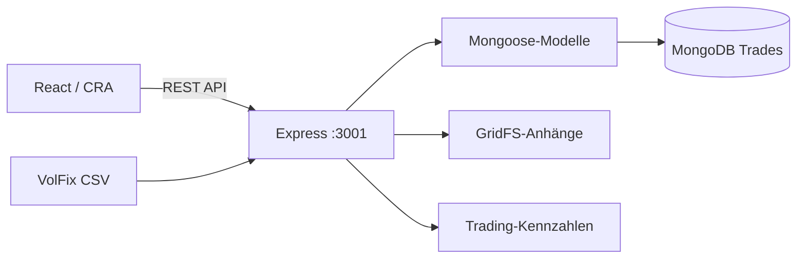

# MES Calc — Trading-Journal und Analyseplattform

**Eine Full-Stack-Anwendung zum Import von VolFix-Trades, zur Performanceanalyse, zur Verwaltung von Anhängen und zur Berechnung von Risikokennzahlen.**

**Sprache:** [English](README.md) · Deutsch · [Bisherige technische Dokumentation](README.legacy.md)

**Technologien:** React 19 · Recharts · Lightweight Charts · Node.js · Express · MongoDB / Mongoose · GridFS · csv-parse

> **Status:** Portfolio-/Demo-Anwendung, keine regulierte Brokerage-Software und kein abgesichertes Multi-User-Finanzprodukt. Die Nutzeridentifikation ist für Demos vorgesehen; das Backend akzeptiert die Kennung im Header `X-User-Id`. Anlageerfolge oder Renditen werden nicht zugesichert.

## Funktionen

- Import von VolFix-CSV-Trades mit Normalisierung von Trennzeichen, Datums- und Zahlenformaten.
- Import-Vorschau per **Dry Run** sowie Zähler für importierte, aktualisierte und übersprungene Einträge.
- Analyse mit Dashboards, Equity-Kurven und Kennzahlen.
- Filter nach Datum, Uhrzeit, Ergebnis, Handelsbedingungen und Tags.
- Verwaltung von Chartbildern und Sprachnotizen mit MongoDB GridFS.
- Ansichten für Risiko-, Positionsgrößen- und Kontraktberechnungen.

## Screenshots

Auswahl **vorhandener** Bilder aus dem Repository. Sie wurden nicht mit dem aktuellen laufenden Build verglichen. Vor einer breiteren Veröffentlichung prüfen, ob private oder echte Handelsdaten sichtbar sind.


Weitere Bilder: [`mes-calc-frontend/public/docs/`](mes-calc-frontend/public/docs/).

## Architektur



| Bereich | Code |
| --- | --- |
| React-Seiten, Charts und Widgets | `mes-calc-frontend/src/` |
| Frontend-API-Client | `mes-calc-frontend/src/lib/api.js` |
| Express-Startpunkt | `mes-calc-backend/server/src/index.js` |
| Trades / Anhänge / Importe | `mes-calc-backend/server/src/routes/` |
| Datenmodelle und Indizes | `mes-calc-backend/server/src/models/` |

## Lokal starten

**Voraussetzungen:** Node.js, npm und ein erreichbarer MongoDB-Server. Zwei Terminals im Repository verwenden.

**Backend:**

```bash
cd mes-calc-backend
npm install
npm run dev
```

Eine lokale `mes-calc-backend/.env` nach Bedarf konfigurieren, beispielsweise mit `MONGO_URI=mongodb://localhost:27017/mes_calc`, `PORT=3001` und `CORS_ORIGIN=http://localhost:3000`. Zugangsdaten nicht committen. Healthcheck: [http://localhost:3001/health](http://localhost:3001/health).

**Frontend:**

```bash
cd mes-calc-frontend
npm install
npm start
```

Danach [http://localhost:3000](http://localhost:3000) öffnen. Der API-Client nutzt standardmäßig `http://localhost:3001`; mit `REACT_APP_API_URL` lässt sich diese Adresse anpassen.

Die Befehle stammen aus dem Projekt und wurden bei der README-Erstellung **nicht ausgeführt**.

## Beispiel: CSV-Import

Der VolFix-Importer ist unter `POST /api/integrations/volfix/import` implementiert. Er akzeptiert Datei-Uploads sowie `dry=1` für eine Vorschau und `update=1` für die Aktualisierung vorhandener Einträge anhand externer Kennungen. Für Demos sollten **synthetische Handelsdaten** verwendet werden.

## Technische Merkmale und Grenzen

- Trennung von React-Oberfläche, Express-Routen, Mongoose-Datenmodellen und GridFS-Anhängen.
- Normalisierung und Testimport demonstrieren die Verarbeitung nicht perfekt formatierter externer Daten.
- Kennzahlen und Charts dienen der Analyse und sind keine Anlageberatung.
- Die aktuelle Identifikation per Header ist **keine** produktionsreife Mandanten-Authentifizierung.
- MongoDB muss lokal eingerichtet werden; kein unabhängig bestätigter öffentlicher Dienst oder CI-Lauf wird behauptet.

## Datenschutzprüfung vor weiterer Veröffentlichung

**Wichtig:** Im öffentlichen Repository sind historische Trading-CSV-Dateien und Dokumente vorhanden. Vor der aktiven Bewerbung prüfen, ob persönliche Unterlagen, echte Kontodaten, Transaktionskennungen oder private Bilder enthalten sind. Eine Löschung im neuesten Commit entfernt keine Kopien aus der Git-Historie.

## Demo für Recruiter

Synthetische CSV als Dry Run importieren → Normalisierung erklären → Testdaten importieren → Dashboard zeigen → Trades filtern → Testbild anhängen → MongoDB-/GridFS-Entwurf erläutern.

## Ausführliche Dokumentation

Frühere API- und Konfigurationsbeschreibung: [`README.legacy.md`](README.legacy.md).

*Portfolio-Schwerpunkte: Datenimport, Analyse-Dashboards, REST-APIs, NoSQL-Modellierung, GridFS und Full-Stack Engineering.*