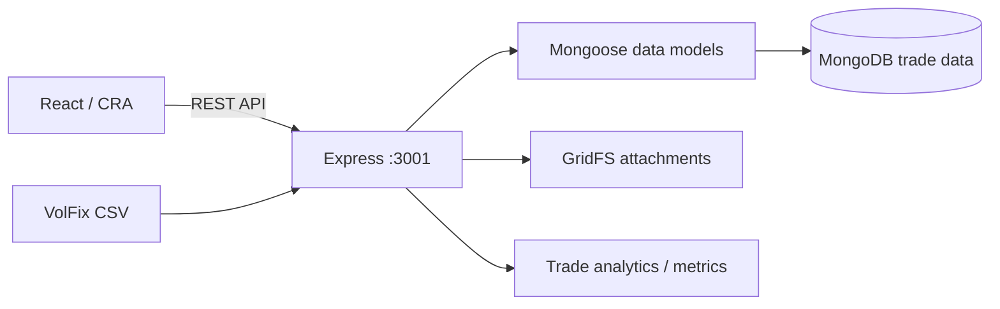

# MES Calc — Trading Journal & Analytics Platform

**A full-stack trading journal for importing VolFix trade records, exploring performance, managing trade attachments and calculating risk metrics.**

**Language:** English · [Deutsch](README.de.md) · [Previous technical documentation](README.legacy.md)

**Stack:** React 19 · Recharts · Lightweight Charts · Node.js · Express · MongoDB / Mongoose · GridFS · csv-parse

> **Status:** Portfolio/demo application, not a licensed brokerage or a production-grade multi-user financial platform. Authentication is demo-oriented; the backend can identify users by the `X-User-Id` request header. No trading performance or financial returns are guaranteed.

## What the application demonstrates

- Import VolFix CSV trade history with delimiter/date/number normalization.
- Preview imports with a **dry-run** option and track imported, updated or skipped records.
- Analyze trading results with dashboards, equity curves and visual metrics.
- Filter by date, time, outcome, trade conditions and tags.
- Store chart screenshots and voice notes as MongoDB GridFS attachments.
- Work with risk, position-size and contract-oriented calculation views.

## Screenshots

Selected **existing** images from the repository. They have not been verified against the latest running build; review any personal or real trading data before using them in a public portfolio.


More existing screenshots: [`mes-calc-frontend/public/docs/`](mes-calc-frontend/public/docs/).

## Architecture



| Layer | Code |
| --- | --- |
| React pages, charts and widgets | `mes-calc-frontend/src/` |
| Frontend API client | `mes-calc-frontend/src/lib/api.js` |
| Express entry point | `mes-calc-backend/server/src/index.js` |
| Trades / attachments / imports | `mes-calc-backend/server/src/routes/` |
| Database models and indexes | `mes-calc-backend/server/src/models/` |

## Run locally

**Prerequisites:** Node.js, npm and a working MongoDB server. Use two terminals from the repository root.

**Backend:**

```bash
cd mes-calc-backend
npm install
npm run dev
```

Configure a local `mes-calc-backend/.env` as needed, with `MONGO_URI=mongodb://localhost:27017/mes_calc`, `PORT=3001`, and `CORS_ORIGIN=http://localhost:3000`. Do not commit credentials. Health: [http://localhost:3001/health](http://localhost:3001/health).

**Frontend:**

```bash
cd mes-calc-frontend
npm install
npm start
```

Open [http://localhost:3000](http://localhost:3000). The frontend defaults to `http://localhost:3001` for API requests; `REACT_APP_API_URL` can override it.

These commands come from existing project scripts and were **not executed** during README preparation.

## CSV import example

The VolFix importer is implemented as `POST /api/integrations/volfix/import`. It accepts file uploads and supports `dry=1` for preview and `update=1` for existing records matched by external identifiers. Use **synthetic trade examples** for any demonstration.

## Engineering decisions and limitations

- Separate React UI, Express routes, Mongoose models and GridFS media storage.
- CSV normalization and preview/update paths demonstrate ingestion of imperfect external data.
- Risk metrics and charts are analytical features, not trading recommendations.
- The current user-identification mechanism is for demo scenarios and must **not** be described as secure multi-tenant authentication.
- MongoDB must be configured locally; no verified public deployment or CI run is claimed.

## Privacy review before wider distribution

**Important:** This public repository currently includes historic trade CSV files and documents in its source tree. Verify that none contains private account data, real transaction identifiers, personal documents or images before promoting it. Removing files from the latest commit alone does not erase historical copies from Git history.

## Suggested recruiter demo

Import a synthetic CSV in dry-run mode → review normalization results → import test data → open analytics → filter trades → attach a synthetic screenshot → explain the MongoDB + GridFS design.

## Detailed docs

Original endpoint inventory and configuration notes: [`README.legacy.md`](README.legacy.md).

*Portfolio focus: data ingestion, analytics dashboards, REST APIs, NoSQL modeling, GridFS and full-stack engineering.*